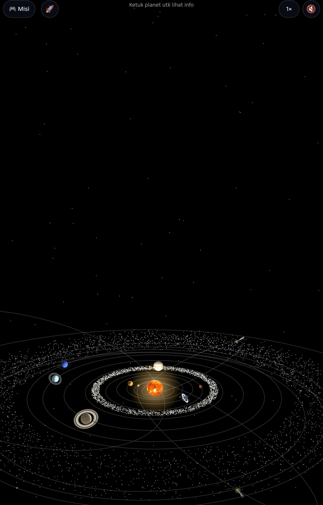
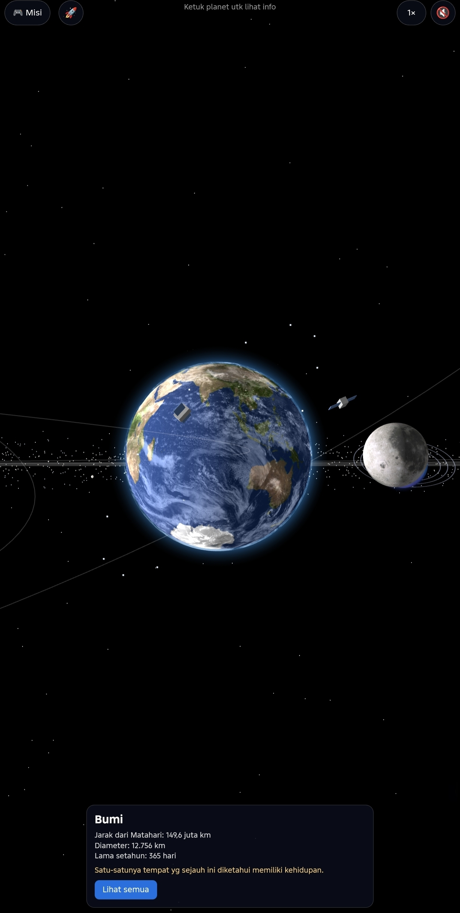

# Solar Odyssey

Simulasi tata surya 3D interaktif yang berjalan di browser (dibuat di HP dengan JavaScript dan Three.js).

## Fitur
- Matahari, 8 planet, planet kerdil, komet, sabuk asteroid, dan sabuk Kuiper dengan orbit elips
- Ketuk planet untuk melihat info dan fakta, kamera terbang mengikuti planet
- Mode misi "Tebak Planet" dengan skor dan pangkat
- Pesawat yang bisa diterbangkan (joystick sentuh), lengkap dengan tabrakan
- Satelit buatan di sekitar Bumi, cincin tipis planet raksasa
- Musik dan efek suara yang dibuat lewat kode (Web Audio), tanpa file audio
- Planet 9 sebagai planet hipotesis
- **📸 Foto pemandangan:** ambil gambar tampilan saat ini (termasuk dari kokpit pesawat), lalu unduh atau bagikan sebagai PNG
- **🌀 Acak-acak planet:**
  - *Gravitasi Liar*: planet lepas dari orbit rel, saling tarik (N-body), bisa bertabrakan dan bergabung, jatuh ke Matahari, atau terlempar. Jejak orbit tampil
  - *Lubang Hitam*: ketuk bidang orbit untuk menaruh (maks. 3), planet melengkung, mengecil, lalu tertelan
  - *Pulihkan* mengembalikan orbit normal, slider mengatur kekuatan tarikan

## Kontrol pesawat
Ketuk tombol 🚀 untuk mulai terbang, lalu:
- **Joystick (kiri bawah):** belok dan naik-turun
- **GAS / REM:** tambah atau kurangi laju (tahan)
- **BOOST:** laju sampai 3× (tahan)
- **AUTO:** kunci laju supaya tidak perlu menahan GAS
- **LURUS:** meluruskan kemiringan pesawat
- **📷:** ganti jarak kamera

## Struktur
```
index.html
css/style.css
js/            dimuat berurutan sesuai index.html
  scene.js         scene, kamera, renderer, kontrol, bintang, cahaya, pemuat tekstur
  sun.js           Matahari dan glow
  helpers.js       garis orbit, atmosfer, cincin
  planets.js       data planet, pembuatan planet, sabuk asteroid
  kuiper-comet.js  sabuk Kuiper dan komet
  spaceship.js     pesawat dan kontrolnya
  interaction.js   ketuk planet, kecepatan waktu
  music.js         musik latar
  quiz.js          mode misi
  extras.js        asteroid, komet tambahan, satelit, suara, tabrakan
  foto.js          tombol 📸, pratinjau, unduh/bagikan
  kacau.js         gravitasi liar, lubang hitam, jejak orbit
  main.js          loop animasi
tekstur/       taruh file tekstur di sini (lihat tekstur/README.md)
```

## Cara menjalankan
Buka lewat server (bukan langsung dari file), misalnya GitHub Pages atau `python -m http.server`.

## Kredit
- Tekstur planet: [Solar System Scope](https://www.solarsystemscope.com/textures/), lisensi CC BY 4.0
- [Three.js](https://threejs.org/) r128

**Demo langsung:** https://rafi-ramadhan-999.github.io/solar-odyssey/





